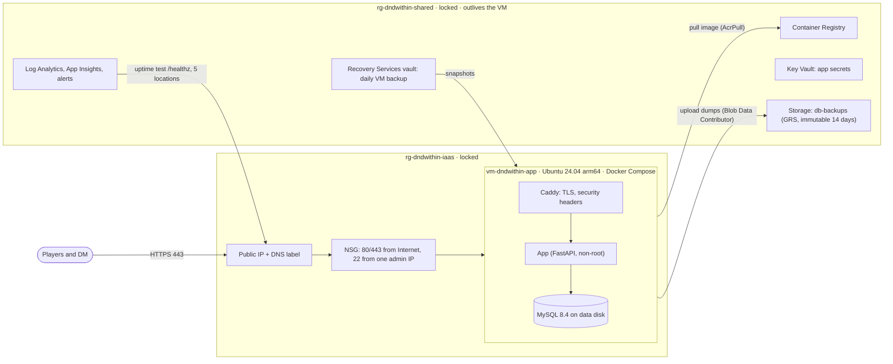
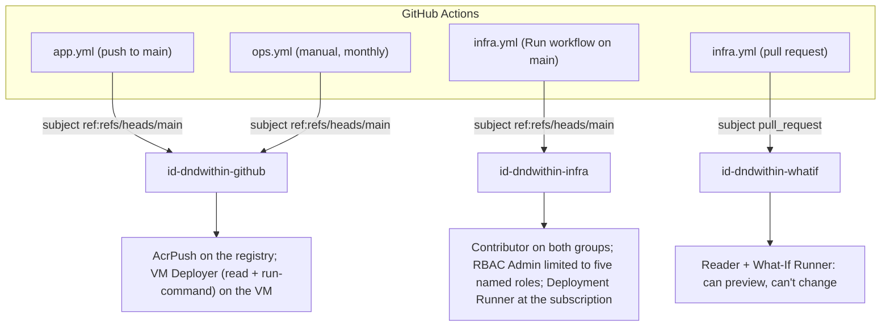

# Architecture

DnD Within runs on one Azure VM in `centralus`. Everything in Azure is defined in Bicep (`infra/bicep/`), and every change reaches production through GitHub Actions with OIDC: no stored cloud credentials, no SSH in CI.

## Resources

Resource groups follow lifecycles: `shared` holds what survives a rebuild or the move to PaaS, `iaas` holds the VM and its network. Both carry a `CanNotDelete` lock. Azure Policy denies resources outside `centralus` and audits resource groups for a `project` tag.

## Identities and permissions

Nothing in CI holds a secret. GitHub issues each workflow run a short-lived OIDC token, and Entra ID exchanges it only if the token's subject matches a federated credential exactly.

| Identity | Can | Can't |
|---|---|---|
| `id-dndwithin-github` | push images, run commands on this one VM | change any resource |
| `id-dndwithin-infra` | deploy `main.bicep`; assign only AcrPush, AcrPull, Storage Blob Data Contributor, Key Vault Secrets User, VM Deployer | assign any other role (an ABAC condition), touch policy, locks, or other resource groups |
| `id-dndwithin-whatif` | read everything, run what-if | write anything; a PR runs its own copy of the workflow, so it only ever gets this identity |
| VM (system-assigned) | pull images, write to `db-backups`, read secrets | anything else |
| Admin (a person) | run `bootstrap.bicep` as Owner; read and write backups and secrets | |

**Bootstrap vs workload.** `bootstrap.bicep` (policy, custom roles, identities, role assignments for people and pipelines, locks) is run by hand, after review, by an Owner. `main.bicep` (registry, network, VM, storage, vaults, monitoring) is deployed by the pipeline. A pipeline that could deploy its own permissions could widen them, so the boundary is enforced in Azure, not by convention.

## Delivery

| Workflow | Trigger | Does |
|---|---|---|
| `app.yml` | pull request | ruff, pytest against MySQL started from the same pinned compose image as production |
| `app.yml` | push to `main` | the checks, then build arm64 + amd64, push to ACR by commit SHA, Trivy scan (fails on fixable HIGH/CRITICAL), deploy, smoke test `https://<site>/healthz` |
| `infra.yml` | pull request touching `infra/` | Bicep lint and build, what-if posted to the job summary |
| `infra.yml` | Run workflow on `main` | what-if with full permission checks, then deploy |
| `ops.yml` | Run workflow, monthly schedule | `backup`, `restore-drill`, `restore` (confirmed by typing `RESTORE`) |

**A deploy** (`scripts/deploy-vm.sh`, run through `az vm run-command`):

1. Ship the compose files, Caddyfile and scripts; install the backup timer.
2. Back up the database, because the new image may run forward-only migrations.
3. Start the new image with `docker compose up --wait`, which fails unless every container passes its healthcheck within 3 minutes.
4. If it's unhealthy, restart the last good image recorded in `.env` and fail the run.
5. Record the new image as the last good one; GitHub then checks `/healthz` from outside.

**Supply chain.** Actions are pinned to commit SHAs and images to digests; Dependabot proposes weekly updates (minor and patch grouped, majors separate, MySQL held on the 8.4 LTS line). The app runs as a non-root user, and the image ships without pip.

## Data protection

| Layer | What | Kept | Protects against |
|---|---|---|---|
| Logical dump | `mysqldump`, daily (systemd timer) and before every deploy, uploaded to Blob Storage | 35 days; immutable for 14 | bad migrations, data mistakes, VM loss, a compromised VM (can't delete or overwrite recent backups) |
| VM backup | Azure Backup, Enhanced policy, daily | 14 days | losing the whole machine, including files that exist only on it |
| Secrets | Key Vault with purge protection | indefinitely | losing `.env` with the VM |

A **restore drill** runs monthly (`ops.yml`): it loads the newest offsite dump into a scratch database next to the live one, compares every table's row count, and fails the workflow if a table is missing or empty. Storage and vaults are geo-redundant (paired region).

## Monitoring

Alerts email one action group:

- **Site down:** a standard availability test on `/healthz` from five US locations every 15 minutes (status 200, body `ok`, TLS valid with more than 7 days left). It fires when 3 of 5 fail, so one location's network trouble isn't an outage. `/healthz` queries the database, so a healthy response means the whole path works.
- **VM backup failed:** Azure Backup's built-in alerts, routed by an alert processing rule.
- **Patching:** Ubuntu's unattended-upgrades installs security updates; Azure Update Manager assesses the VM daily, so missing patches are visible in Azure.
- **No database backup in 24 hours:** a log alert on the backup account's write logs; catches the timer, the dump or the upload silently breaking.

## Decisions

| Decision | Why | Trade-off |
|---|---|---|
| Run Command instead of SSH for deploys and operations | RBAC-scoped, audited in the Activity Log, no key in CI, no inbound port needed | It reports success regardless of the script's exit code, so scripts print a success marker that the workflow checks |
| Manual Run workflow to apply infrastructure | Required reviewers on environments need GitHub Enterprise for a private repo; starting the run is the approval | Relies on discipline, not enforcement |
| What-if on PRs skips permission checks (`ProviderNoRbac`) | Preflight normally demands write access, which a PR identity must never have | Permission problems surface on the deploy run instead, which keeps full checks |
| Caddy on the VM for TLS | Automatic Let's Encrypt certificates at no cost | Replaced by App Service's managed TLS in Stage 2 |
| Enhanced backup policy | Supports Trusted Launch and is Azure's current default | None at this scale |
| Version-level immutability, unlocked | Protects recent backups from deletion while settings can still be tuned | Not yet locked, so an Owner could remove it |

## Known limitations

- **One VM, no redundancy.** A single VM with Premium SSD has a 99.9% SLA; a host failure means downtime until Azure restarts it.
- **`.env` is created by hand on the VM.** Its secrets are also in Key Vault, but the VM doesn't read them from there. Doing that properly is part of Stage 2.
- **SSH is still open to one admin IP**, because third-party content packs are copied to the VM by hand. It closes when content gets its own pipeline.
- **Rollback can't undo migrations.** A rollback restarts the previous image against the current schema; the pre-deploy dump is the way back from a bad migration.
- **Up to 24 hours of data loss** between daily dumps (less around deploys).
- **No guest-level metrics** (disk, memory) from inside the VM.
- **Old images accumulate in the registry.** A scheduled `acr purge` needs care with multi-arch images, whose per-architecture manifests are untagged; it's deferred until it can be tested safely.

## Next: Stage 2 (PaaS)

App Service (containers) and Azure Database for MySQL Flexible Server, in a new resource group:

- Point-in-time restore replaces dumps as the primary backup; geo-redundant backup storage.
- Key Vault references inject secrets as app settings; no `.env`.
- Deployment slots and swap replace run-command deploys; health check replaces the compose healthcheck.
- The VM, its backup, Caddy, run-command operations and SSH are retired; monitoring carries over unchanged.
