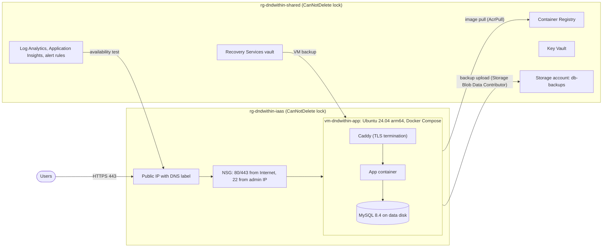
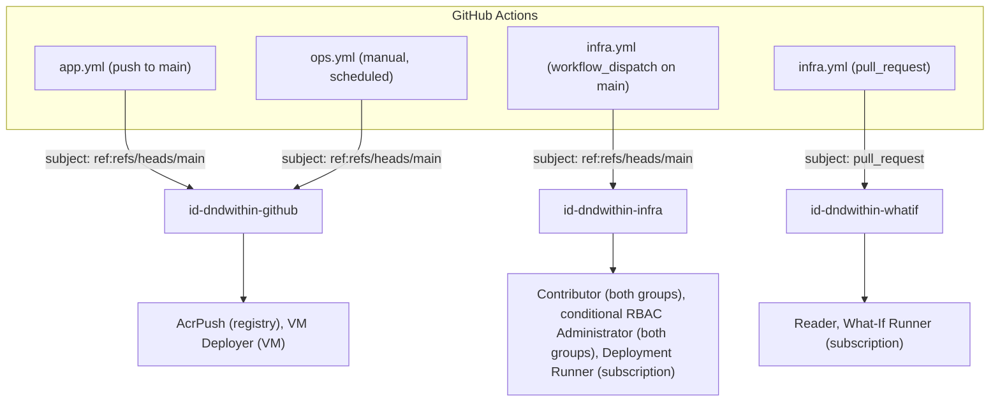

# Architecture

DnD Within runs on a single Azure VM in `centralus`. All Azure resources are defined in Bicep under `infra/bicep/`. Application and infrastructure changes are deployed by GitHub Actions, which authenticates to Azure with OpenID Connect (OIDC) workload identity federation.

## Resources

| Resource group | Contents | Lifecycle |
|---|---|---|
| `rg-dndwithin-shared` | Container Registry, Key Vault, backup storage account, Recovery Services vault, monitoring, CI identities | Retained across VM rebuilds and the planned move to PaaS |
| `rg-dndwithin-iaas` | VM, NIC, disks, VNet, NSG, public IP | Removed when the workload moves to PaaS |

Both resource groups have a `CanNotDelete` management lock. An Azure Policy assignment denies resource creation outside `centralus`, and a second assignment audits resource groups for a `project` tag.

## Identities and permissions

GitHub Actions requests a short-lived OIDC token for each workflow run. Entra ID exchanges the token for an access token only when its issuer, subject and audience match a federated credential on a user-assigned managed identity. No client secrets or certificates are stored in GitHub.

| Principal | Role assignments | Scope |
|---|---|---|
| `id-dndwithin-github` | Reader; AcrPush; VM Deployer (custom: `virtualMachines/read`, `runCommand/action`) | `rg-dndwithin-shared`; registry; VM |
| `id-dndwithin-infra` | Contributor; Role Based Access Control Administrator with an ABAC condition; Deployment Runner (custom: `Microsoft.Resources/deployments/*`) | both resource groups; both resource groups; subscription |
| `id-dndwithin-whatif` | Reader; What-If Runner (custom: `deployments/whatIf/action`, `deployments/validate/action`) | subscription |
| VM system-assigned identity | AcrPull; Storage Blob Data Contributor; Key Vault Secrets User | registry; `db-backups` container; key vault |
| Administrator | Owner; Storage Blob Data Contributor; Key Vault Secrets Officer | subscription; `rg-dndwithin-shared`; `rg-dndwithin-shared` |

The ABAC condition on the infra identity's RBAC Administrator assignment restricts role assignment writes and deletes to five role definitions: AcrPush, AcrPull, Storage Blob Data Contributor, Key Vault Secrets User and VM Deployer.

Infrastructure is split into two deployments:

- `bootstrap.bicep` contains policy assignments, custom role definitions, the CI identities and their federated credentials, role assignments for people and pipelines, and resource locks. An Owner deploys it manually after review.
- `main.bicep` contains the workload: registry, network, VM, storage, vaults and monitoring. The infra pipeline deploys it. It references the resource groups and identities created by bootstrap as existing resources, so it cannot change the permissions of the identity that deploys it.

## Delivery

| Workflow | Trigger | Steps |
|---|---|---|
| `app.yml` | pull request | ruff; pytest against MySQL started from the pinned image in `docker-compose.yml` |
| `app.yml` | push to `main` | checks; multi-arch build (arm64, amd64) tagged with the commit SHA; push to ACR; Trivy scan, failing on fixable HIGH or CRITICAL findings; deploy; smoke test of `/healthz` |
| `infra.yml` | pull request changing `infra/` | Bicep lint and build; what-if as `id-dndwithin-whatif`, written to the job summary |
| `infra.yml` | `workflow_dispatch` on `main` | what-if and deployment as `id-dndwithin-infra` |
| `ops.yml` | `workflow_dispatch`; monthly schedule | `backup`, `restore-drill`, or `restore` from a named blob (requires typing `RESTORE`) |

Application deploys run `scripts/deploy-vm.sh` on the VM through `az vm run-command`:

1. Extract the compose files, Caddyfile and scripts, and install the backup systemd timer.
2. Take a database backup before starting the new image, since migrations run at startup and only go forward.
3. Start the new image with `docker compose up --wait --wait-timeout 180`, which returns non-zero if a container is not healthy within the timeout.
4. On failure, start the previous image recorded in `.env` and exit with an error.
5. On success, record the new image in `.env`. The workflow then requests `/healthz` over the public endpoint.

GitHub Actions are pinned to commit SHAs and container images to digests. Dependabot opens weekly update pull requests, grouping minor and patch updates and ignoring MySQL minor and major versions to stay on the 8.4 LTS line. The application container runs as a non-root user, and pip is removed from the image.

## Data protection

| Layer | Mechanism | Retention | Recovery scope |
|---|---|---|---|
| Logical backup | `mysqldump` daily via systemd timer and before each deploy, uploaded to the `db-backups` container | 35 days (lifecycle policy); 14 days immutable | Database contents; table-level restore |
| VM backup | Azure Backup, Enhanced policy, daily at 03:30 UTC | 14 days | Full VM, including OS disk contents |
| Secrets | Key Vault, RBAC authorization, purge protection | Soft delete, 90 days | Application secrets |

The backup storage account uses GRS, Entra ID authentication only (shared key access disabled), blob versioning, soft delete and version-level immutability. The VM identity can write backups but cannot modify or delete them during the 14-day immutability period. The Recovery Services vault uses geo-redundant storage with soft delete enabled.

The `restore-drill` operation in `ops.yml` runs monthly. It restores the newest blob into a separate database on the same MySQL instance, compares row counts for every table against the live database, fails if a table is missing or empty, and drops the separate database.

## Monitoring

All alert rules notify one action group by email.

| Alert | Source | Condition |
|---|---|---|
| Site down | Standard availability test on `https://<site>/healthz` from five US locations every 15 minutes; checks status 200, response body `ok`, and certificate validity with at least 7 days remaining | 3 of 5 locations failing |
| VM backup failed | Azure Backup built-in Azure Monitor alerts, routed by an alert processing rule | Any backup job failure |
| No database backup | Log search alert on `StorageBlobLogs` (StorageWrite diagnostic logs from the backup account) | No successful upload to `db-backups` in 24 hours, evaluated hourly |

`/healthz` executes `SELECT 1` against the database. The Log Analytics workspace has 30-day retention and a 0.5 GB daily ingestion cap.

Security updates are installed by Ubuntu's unattended-upgrades. Azure Update Manager periodic assessment is enabled on the VM, reporting update compliance every 24 hours without installing updates.

## Design decisions

| Decision | Reason | Consequence |
|---|---|---|
| Run Command for deploys and operations | Access is controlled by RBAC and recorded in the Activity Log; no inbound port or SSH key required in CI | Run Command reports success regardless of the script's exit code; scripts print a success marker that the workflow checks |
| Infrastructure applied by manual `workflow_dispatch` | Required reviewers on GitHub environments are not available for private repositories on the current plan | Approval is the act of starting the run rather than an enforced review step |
| PR what-if uses `--validation-level ProviderNoRbac` | Default preflight validation requires write permission on every resource, which the PR identity does not have | Permission errors appear on the deploy run, which uses full validation |
| Caddy for TLS | Automatic Let's Encrypt certificate issuance and renewal | Replaced by App Service managed certificates in Stage 2 |
| Enhanced backup policy | Required for Trusted Launch VMs; current Azure default | None at this scale |
| Immutability policy left unlocked | Retention can still be adjusted | A user with sufficient rights can remove the policy until it is locked |

## Known limitations

- Single VM with no redundancy. A single-instance VM with Premium SSD has a 99.9% SLA.
- `.env` on the VM is created manually. Its secrets are stored in Key Vault, but the VM does not read them from there.
- SSH (port 22) is open to one administrator IP address, used to copy third-party content packs to the VM.
- Rollback restarts the previous image but does not reverse database migrations. A bad migration is recovered from the pre-deploy backup.
- The database recovery point objective is up to 24 hours.
- No guest OS metrics (disk usage, memory) are collected.
- Old images are not purged from the registry. `acr purge` has not been configured because multi-arch images reference untagged per-architecture manifests, and the purge behavior for them has not been tested.

## Stage 2

The planned move to PaaS uses Azure App Service (Linux containers) and Azure Database for MySQL Flexible Server in a new resource group:

- Point-in-time restore and geo-redundant backup storage on Flexible Server replace logical dumps as the primary backup.
- App settings use Key Vault references, replacing `.env`.
- Deployment slots and slot swap replace Run Command deploys, and the App Service health check replaces the compose healthcheck.
- The VM, its Azure Backup protection, Caddy, the Run Command operations and the SSH rule are removed. Monitoring resources are reused.
